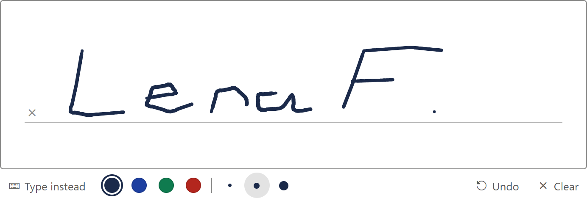

# Signature Pad for Oracle APEX

A page item where users sign with a mouse, finger or pen, or type their name, and the signature is saved as an image.

[](https://oracleapex.com/ords/r/aamirkhanz/plugins/signature-pad) &nbsp; Sign in as `demo` with the password `Demo`.



| | |
|---|---|
| **Type** | Item plug-in |
| **Internal name** | `COM.TECHREVX.SIGNATURE_PAD` |
| **Version** | 1.0 |
| **Requires** | Oracle APEX 26.2 or later |
| **License** | MIT |

## What it does

Signature Pad is a page item for signatures: delivery receipts, consent forms, approvals and inspections. Users sign with a mouse, a finger or a pen, and the item's value is the signature as an image, ready to save in a BLOB column or put in a report.

- **Natural lines**: the line gets thinner when the pen moves faster, like ink. Fine, medium and bold pens in any color.
- **Pen choices**: users pick the line color from your color swatches and the line size (fine, medium, bold); each stroke keeps the color and size it was drawn with.
- **Type instead**: users can type their name, which is drawn in a handwriting font. This also makes the item usable with a keyboard only.
- **Undo and Clear**, a signature line with an x, and a placeholder such as "Sign here".
- **Output**: PNG, JPEG or SVG, cropped to the signature and scaled to a maximum width so values stay small.
- **Form ready**: Value Required, read only (shows the image), disable and enable, and Change events.
- **Responsive**: the pad fills the item's width, keeps a 2:1 shape on phones (up to the Height you set), and scales the signature to fit when the screen size or orientation changes.

## At a glance

- **Value**: an image data URL (PNG, JPEG or SVG). Set Session State Data Type to CLOB. Save it to a BLOB with apex_web_service.clobbase642blob( substr( :P1_SIGNATURE, instr( :P1_SIGNATURE, ',' ) + 1 ) ).
- **Drawing**: smooth, pressure-like lines (the faster the pen, the thinner the line), undo, clear, a signature line and a placeholder. With Pen Choices, users pick the line color and size (Fine, Medium, Bold). The pad is responsive: on narrow screens it keeps a 2:1 shape up to the Height, and the signature scales to fit when the pad changes size.
- **Type Instead**: users type their name and it is drawn in a handwriting font, so the item also works with a keyboard.
- **Output**: PNG, JPEG or SVG, cropped to the signature and scaled to a maximum width. Read only items show the image.
- **Validation**: Value Required works on the server and in the browser. JavaScript: apex.item( "P1_SIGNATURE" ).getValue(), setValue( dataUrl ), isEmpty(). Events: Change, Signature Pad - Signing Started, Signature Pad - Cleared.

## Installation

1. Download `plugin/item_type_plugin_com_techrevx_signature_pad.sql` from the [latest release](https://github.com/aamirkhanz/apex-plugin-signature-pad/releases/latest) (or from this repository).
2. In App Builder, open your application and go to **Shared Components > Plug-ins**.
3. Choose **Import**, select the file and finish the wizard.
4. Set a page item's type to **Signature Pad [Plug-in]** and its Session State Data Type to CLOB.

Everything the plug-in needs is inside the SQL file, including signature_pad; it loads nothing from other sites.

## Example

```sql
-- Process: save the signature as a BLOB
declare
    l_value clob := apex_session_state.get_clob( 'P20_SIGNATURE' );
begin
    update deliveries
       set signature      = apex_web_service.clobbase642blob( substr( l_value, instr( l_value, ',' ) + 1 ) ),
           signature_mime = substr( l_value, 6, instr( l_value, ';' ) - 6 ),
           signed_by      = :P20_NAME,
           signed_on      = sysdate
     where delivery_id = :P20_DELIVERY_ID;
end;
```

To show a stored signature again, load it into the item as a data URL, for example with `'data:image/png;base64,' || apex_web_service.blob2clobbase64( signature, 'N', 'N' )`, and set the item to read only.

## Attributes

### Pad

| Attribute | Type | Default | Description |
|---|---|---|---|
| **Height** (required) | Integer | `200` | Height of the drawing area; with Responsive sizing it is the maximum height. The pad is always as wide as the item. |
| **Sizing** (required) | Select list | `responsive` | Responsive: the pad keeps a 2:1 shape on narrow screens, up to the Height, and at least 120 px tall. Fixed: always the Height. Either way the signature is scaled to fit when the pad changes size. Values: `responsive` Responsive, `fixed` Fixed Height. |
| **Pen Color** (required) | Color | `#1b2a4a` | Color the pad starts with. With Pen Choices, users can pick another one from Pen Colors. |
| **Pen Colors** | Text | `#1b2a4a,#1d3fa0,#0f7b4f,#b3261e` | Colors users can choose from when Pen Choices is on, as CSS colors separated by commas. The Pen Color is always offered first. |
| **Pen Width** (required) | Select list | `medium` | Line size the pad starts with; with Pen Choices, users can switch between Fine, Medium and Bold. The line gets thinner when the pen moves faster, like ink. Values: `fine` Fine, `medium` Medium, `bold` Bold. |
| **Background Color** | Color |  | Paper color of the pad, also used behind the saved image. Leave empty for a transparent PNG or SVG; JPEG images get white. |
| **Placeholder** | Text | `Sign here` | Text shown on the empty pad. |
| **Features** | Checkboxes | `undo:clear:type:line:pen` | Undo: removes the last stroke. Clear: empties the pad. Type: lets users type their name instead of drawing it, which also makes the item usable with a keyboard. Signature Line: a baseline with an x to sign on. Pen Choices: color swatches (from Pen Colors) and Fine, Medium and Bold line sizes; each stroke keeps the color and size it was drawn with. Values: `undo` Undo, `clear` Clear, `type` Type Instead, `line` Signature Line, `pen` Pen Choices. |

### Output

| Attribute | Type | Default | Description |
|---|---|---|---|
| **Image Format** (required) | Select list | `png` | The item value is a data URL of this image type, for example data:image/png;base64,iVBOR... PNG keeps a transparent background; JPEG is smaller; SVG stays sharp at any size. Values: `png` PNG, `jpeg` JPEG, `svg` SVG. |
| **Crop to Signature** | Checkboxes | `trim` | Removes the empty space around the signature in PNG and JPEG images, so they are small and line up when shown. Values: `trim` Crop to Signature. |
| **Maximum Image Width** (required) | Integer | `600` | PNG and JPEG images wider than this are scaled down, which keeps the value small. Set the item's Session State Data Type to CLOB for values above 32 KB. |

## Events

Available in Dynamic Actions, and as jQuery events on the region or item:

- **Signature Pad - Cleared** (`tx-signaturepad-clear`)
- **Signature Pad - Signing Started** (`tx-signaturepad-begin`)

## Value

The item's value is a data URL of the image, or empty when nothing is signed. Other values are ignored when the page is shown.

```text
data:image/png;base64,iVBORw0KGgoAAAANSUhEUgAAAlgAAABu...
data:image/jpeg;base64,/9j/4AAQSkZJRgABAQAAAQABAAD...
data:image/svg+xml;base64,PHN2ZyB4bWxucz0iaHR0cDovL3d3...
```

A cropped PNG at 600 pixels wide is usually 10 to 30 KB. Set Session State Data Type to CLOB so larger values are kept, and read them with `apex_session_state.get_clob`: a bind such as `:P20_SIGNATURE` is limited to 32 KB.

```sql
-- the image type and the BLOB
substr( l_value, 6, instr( l_value, ';' ) - 6 )                               -- image/png
apex_web_service.clobbase642blob( substr( l_value, instr( l_value, ',' ) + 1 ) ) -- BLOB
```

## Events and JavaScript

```text
Change                          after each stroke, Undo, Clear or typed name
Signature Pad - Signing Started  the pen touches the pad
Signature Pad - Cleared          the user chose Clear
```

```javascript
apex.item( "P20_SIGNATURE" ).getValue();        // the data URL, or ""
apex.item( "P20_SIGNATURE" ).isEmpty();         // true when nothing is signed
apex.item( "P20_SIGNATURE" ).setValue( "" );    // clear the pad
apex.item( "P20_SIGNATURE" ).setValue( url );   // show an image data URL
apex.item( "P20_SIGNATURE" ).disable();         // stop drawing; the value is not submitted

// the pen for the next strokes, as with Pen Choices: color and fine | medium | bold
techrevx.signaturePad.get( "P20_SIGNATURE" ).setPen( { color: "#b3261e", width: "bold" } );
```

### Initialization JavaScript Function

Receives the options and returns them. `padOptions` is passed to signature_pad, for example to change how much the speed affects the line width.

```javascript
function( options ) {
    options.padOptions = { velocityFilterWeight: 0.5, minDistance: 3 };
    return options;
}
```

### Styling

The pad is `.tx-Sig-area`, the signature line `.tx-Sig-line` and the buttons `.tx-Sig-btn`. It follows the Universal Theme field colors and radius.

## Included libraries

| Library | Version | License |
|---|---|---|
| [signature_pad](https://github.com/szimek/signature_pad) | 5.1.4 | MIT |

See [THIRD-PARTY-NOTICES.md](THIRD-PARTY-NOTICES.md).

## Repository contents

- `plugin/item_type_plugin_com_techrevx_signature_pad.sql`: the plug-in, ready to import
- `src/`: the plug-in's own source (PL/SQL in `plugin.pls`, JavaScript and CSS), for reading and reviewing; the SQL file already contains it
- `apexplugin.json`: the plug-in's details for [apex.world](https://apex.world)

## License

MIT, see [LICENSE](LICENSE). The included libraries keep their own licenses.

## More plug-ins

Documentation, updates and more plug-ins for Oracle APEX by [TechRevX](https://www.techrevx.com).
